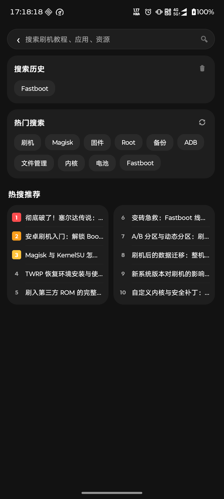
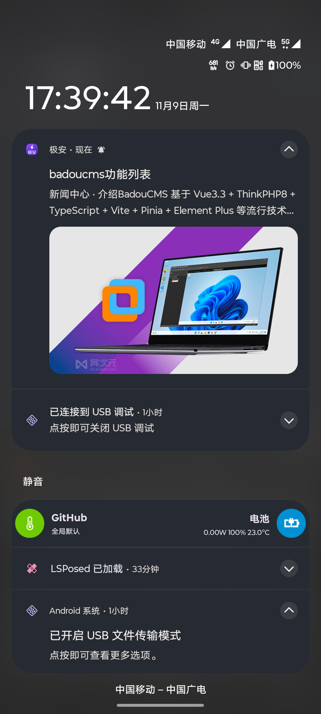

# 极安 Seefox

一个面向安卓刷机、玩机人群的资讯客户端。内容来自自建站点 `seesun.eu.org`，覆盖安卓刷机、手机数码、应用推荐、搞机教程、资源下载五个栏目，加上新闻中心。

界面按「卡片 + 列表」的资讯流方式组织，深浅色完全跟随系统，附带后台定时检查 + 状态栏图文大图通知。

| 搜索页 | 新文章通知 |
| --- | --- |
|  |  |

## 功能

**首页**
- 顶部：左侧 36dp「极安」Logo + 圆角搜索框，上滑时搜索行折叠、下拉恢复，点 Logo 进入「我的」
- 频道标签栏固定不折叠：推荐 / 安卓刷机 / 手机数码 / 应用推荐 / 搞机教程 / 资源下载
- 大图 Banner 轮播，只取有封面的最新文章，可点进详情
- 今日热点：按本机点击次数排序取前 5 的滚动条
- 软件专区 / 最新发布：双栏目列表，卡片背景 + 图片右侧起下划线

**搜索页**
- 搜索历史：本地保存最多 10 条，去重、最新置顶、可清空，默认展示 6 条并可展开
- 热门搜索：从站内全部文章的标题 / 摘要 / 分类统计出的高频词，点任何一个都能出结果
- 热搜推荐：双列榜单，按真实点击量排序，前三名红 / 橙 / 黄序号

**详情页**
- 文章标题、分类、日期、正文（WebView 渲染，禁止缩放）
- 所有入口都直传完整文章对象，不按 id 二次查缓存，避免文不对题

**新文章通知**
- 后台定时检查站点 `news.json`，出现新文章时发状态栏图文大图通知（封面 + 标题 + 分类 + 摘要）
- 点击通知直达文章详情
- 打开 APP 时立即检查一次；后台每 30 分钟检查一次

**其他**
- 深浅色跟随系统（`values` / `values-night` 两套配色齐全）
- 数据层带 SharedPreferences 磁盘缓存：冷启动先读缓存立即渲染，再后台静默拉取

## 下载安装

最新版本见 [Releases](https://github.com/kingsoftman/SeefoxNews/releases)。

当前版本 **v1.0.0**： [`app-debug-v1.0.0.apk`](https://github.com/kingsoftman/SeefoxNews/releases/download/v1.0.0/app-debug-v1.0.0.apk)

- 最低系统：Android 7.0（API 24）
- 包名：`com.hongtian.seefox`
- 为 debug 签名包，可直接安装

**通知功能需要两个手动设置**（否则定时检查会被系统限制）：
1. 系统设置 → 应用 → 极安 → 允许**自启动 / 后台活动**
2. 不要把 APP 在最近任务里彻底划掉

## 技术栈

- Kotlin，AndroidX（AppCompat、ViewPager2、RecyclerView、SwipeRefreshLayout）
- WorkManager 2.9.1：周期任务做新文章检查
- Glide：图片加载
- SharedPreferences：文章缓存、搜索历史、点击计数、通知基线
- 自定义 `FlowLayout`：搜索页标签流式换行

`compileSdk 34` / `targetSdk 34` / `minSdk 24`，JVM 17。

## 数据源

| 用途 | 地址 |
| --- | --- |
| 最新发布 / 全站文章 | `https://seesun.eu.org/news.json` |
| 今日热点（旧静态源） | `https://kingsoftman.github.io/soft-news/articles.json` |

两个接口返回结构为 `{ "articles": [ { id, title, category, date, excerpt, cover, htmlContent } ] }`。

分类字段为中文栏目名：`安卓刷机`、`手机数码`、`应用推荐`、`搞机教程`、`资源下载`、`新闻中心`。

## 项目结构

```
app/src/main/java/com/hongtian/seefox/
├── MainActivity.kt          底部五个 Tab，hide/show 方式切换 Fragment
├── SplashActivity.kt        启动页，初始化缓存并并行预拉两份数据
├── HomeFragment.kt          首页顶部搜索行折叠、Logo 跳转、频道标签
├── NewsListFragment.kt      首页多分区列表（Banner / 今日热点 / 软件专区 / 最新发布）
├── CategoryFragment.kt      分类页，复用首页数据做本地过滤
├── SearchActivity.kt        搜索页（历史 / 热门 / 热搜榜 / 结果）
├── SoftwareDetailActivity.kt 文章详情（WebView 直传渲染）
├── SoftwareNewsData.kt      数据层：双数据源、磁盘缓存、点击计数
├── SeefoxApp.kt             Application：建通知渠道、注册定时任务
├── NewsCheckWorker.kt       新文章检查 Worker
├── NewsNotify.kt            通知渠道与图文大图通知
└── FlowLayout.kt            流式布局
```

## 构建

用 Android Studio 打开项目直接 Build 即可。

命令行构建（需要本机已安装 Gradle 8.10.2 与 Android SDK 34）：

```bash
gradle assembleDebug
adb install -r app/build/outputs/apk/debug/app-debug.apk
```

> 仓库内 `gradle/wrapper` 只包含配置文件，未包含 `gradle-wrapper.jar`，所以 `./gradlew` 不可用；Android Studio 会按 `gradle-wrapper.properties` 里的版本自行下载 Gradle。

## 已知限制

- 通知不是真正的服务端推送。国内厂商推送通道（小米 / 华为 / 荣耀 / OPPO / vivo）需要企业资质接入，FCM 在国内设备不可用，因此采用的是 WorkManager 定时比对 + 本地通知方案。
- 时效性为：打开 APP 即时检查，纯后台最长 30 分钟一次，且依赖系统不杀后台。
- 一次发现多篇新文章时只弹最新一篇，其余在通知正文里提示数量。

## 版本

- **v1.0.0**（2026-11-09）首个发布版本
